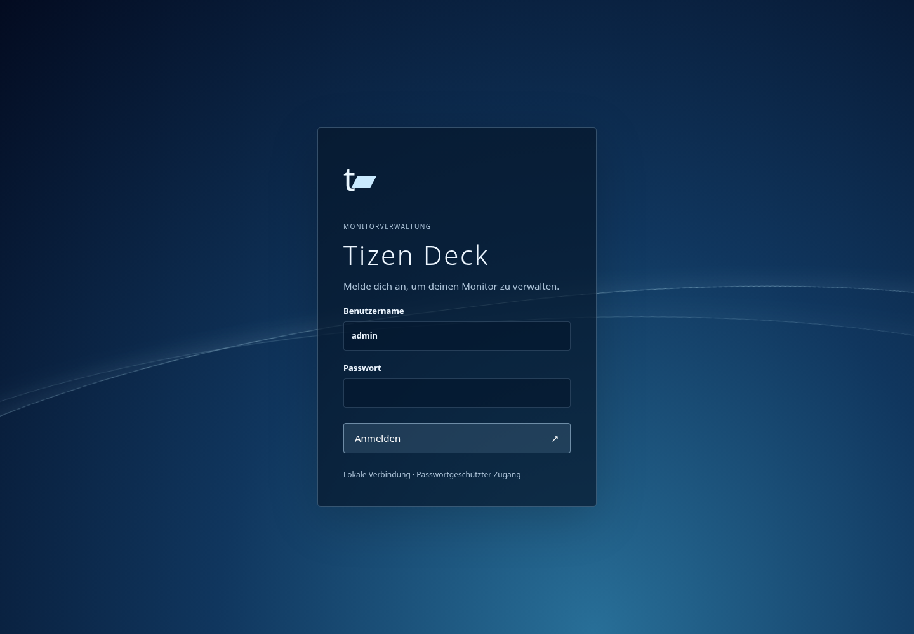

# Tizen Deck

## Screenshot

Anmeldeseite der Version 1.0 in einer lokalen Browser-Vorschau ohne Verbindung
zum TV und ohne Zugangsdaten. [Launcher-Screenshots](https://github.com/LabDennis/tizen-deck-xmb#screenshots).



## Öffentliche Version 1.0

Der projektspezifische Code wurde zum Großteil mit KI (OpenAI Codex) erstellt und
überarbeitet. LabDennis hat Anforderungen, Gestaltung und Entscheidungen vorgegeben
und Funktionen am eigenen Samsung M7 geprüft. KI-generiert bedeutet nicht fehlerfrei
oder umfassend geprüft; die dokumentierten Tests und Grenzen gelten weiterhin.
Drittprojekte, Samsung-APIs und der verwendete Root-Exploit bleiben Arbeiten ihrer
jeweiligen Urheber.

Die öffentliche Versionszählung beginnt bei **1.0** (Paketversion **1.0.0**).
Ältere private Entwicklungsstände trugen höhere Nummern (Launcher 1.11.3,
TV-Dienst 1.9.1). Die folgenden historischen Testberichte behalten diese Nummern.
Der normale Updater verweigert deshalb den Wechsel von diesen Entwicklungsständen
auf 1.0.0. Dafür ist eine bewusst geplante manuelle Installation mit vorheriger
Sicherung erforderlich; die Downgrade-Prüfung bleibt erhalten. Dieser Release
ändert keine bestehende Installation auf dem TV.

Lokale, passwortgeschützte Webverwaltung für Samsung-Tizen-Monitore: Status, Prozesse, Dienste, Pakete, Netzwerk, Fernbedienung und Konsole. Die externe Bridge verwendet ausdrücklich gewählte temporäre Root-Sitzungen; optional kann ein eigener Dienst direkt auf dem Monitor laufen.

Ab TV-Dienst 1.9.1: [private signierte Updates vom PC](docs/LAN-UPDATES.md)
für Dienst und Launcher sowie ein geprüfter Launcher-Neustart über die Remote-CLI.

## Installation (Linux x86_64)

Voraussetzungen: Python 3.12+, Git, curl, Netzwerk zum eigenen Monitor.

```sh
git clone https://github.com/LabDennis/tizen-deck.git
cd tizen-deck
bash install.sh 192.0.2.10
bash start.sh
```

`192.0.2.10` durch die TV-IP ersetzen. Öffnen: http://localhost:8765. Benutzer `admin`; das beim ersten Start erzeugte Passwort liegt ausschließlich lokal in `.state/initial-login.txt`. Nach der Anmeldung in Einstellungen ändern.

Optional mit Root-Unterstützung:

```sh
bash install.sh 192.0.2.10 --root-support
```

Der Installer lädt Werkzeuge herunter und konfiguriert nur den PC. Er führt keinen Root-Vorgang auf dem TV aus. Erst eine ausdrücklich gewählte Root-Aktion baut eine temporäre Sitzung auf. Kein Boot-Hook, kein Firewall-Umbau, kein dauerhafter Root-Dienst.

## Anleitung

[Installation, Entwicklermodus, Netzwerk, Root, Backup und Entfernung](docs/GUIDE.md).

[PC-Fernbedienung und Einschalten aus Standby](docs/PC-REMOTE.md): `python3 pc_remote.py`
öffnet eine interaktive CLI mit Pfeiltasten, OK und Zurück. Einzelbefehle,
PNG-Aufnahmen und Wake-on-LAN über die externe Bridge sind ebenfalls verfügbar.
Das vorhandene Webinterface bleibt als Browser-Fernbedienung nutzbar.

[Deck als Standard-Home, Autostart und Rückweg zu Samsung](docs/DEFAULT-HOME.md):
optional, separat eingerichtet und auf dem M7 geprüft.

[App-Sitzungen automatisch schließen](docs/APP-LIFECYCLE.md): Standardoption im
Launcher ab 1.6.0, mit laufendem nativen TV-Dienst.

[Aktueller Systemausbau](docs/TV-SERVICE.md): native Audiobedienung, Netzstatus,
rückgängig machbare Datenschutz-Sperren, signierte Launcher- und Backend-Updates mit Rückfall
und begrenzte Absturzbehandlung. [Geprüfte Grenzen der Geräteeinstellungen](docs/DEVICE-SETTINGS-STATUS.md).
[Stand der Boot-Untersuchung](docs/BOOT-RESEARCH.md).

## Getestet

Samsung LS32BM700UUXEN, T-NKLBWWC-1720.7, Tizen 6.5, ARMv7, .NET 3.1. Keine allgemeine Kompatibilitätszusage für andere Modelle. Web-Login und Live-Messungen sowie temporärer Root-Zugriff wurden an diesem Gerät geprüft. Automatisierte Tests prüfen Zugriffsschutz, CSRF und Auftragsverarbeitung. Fernbedienungs-WebSocket benötigt die Zustimmung am TV. Echte PNG-Bildschirmaufnahmen werden unterstützt; flüssiges Video-Streaming ist nicht implementiert.

Tests: `.venv/bin/python -m unittest discover -s tests -v`.

## Abhängigkeiten

Root-/SDK-Brücke: [samsung-tv-root](https://github.com/chris-ritsen/samsung-tv-root), Commit `3b97edf3762db7670585d73e29623dc56195bf98`, Unlicense. SDB und Root-Release werden heruntergeladen und per SHA-256 geprüft. Sie sind nicht Teil dieses Repositorys. Private Zustände, Tokens, Dumps und Autorenschlüssel gehören niemals ins Repository.

## Monitor view and scoped input

The Remote page displays real compositor PNG captures. Capture requires temporary root; no persistent daemon is installed. Auto refresh waits 15 seconds after each capture and stops when leaving the tab/page or on an error. Only the latest PNG is retained in memory, behind the existing session authentication; responses are not cached. Video, protected content and HDMI planes are not yet verified. This is not a smooth video stream.

Keyboard and experimental pointer forwarding are limited to hovering over the image. Leaving the image/window clears pending input. Arrow keys, Enter, Escape, Backspace and Tab use remote keys; text requires a supported TV input field. Click means remote OK, right click means Back, wheel means navigation. Pointer coordinates use the captured image dimensions; Samsung firmware support is model dependent. No arbitrary command execution is exposed by the input endpoint.

Protocol reference: https://github.com/xchwarze/samsung-tv-ws-api/blob/master/samsungtvws/remote.py (`ProcessMouseDevice`).

## Deployment packages

- **External Linux Docker backend:** `./docker-install.sh TV_IPV4`; uses host
  networking for the TV callbacks and binds the dashboard to localhost. Access
  remotely with an SSH tunnel. Credentials persist in a named volume.
- **Native TV backend:** build/install and limitations are described in
  [TV-SERVICE.md](docs/TV-SERVICE.md). Includes signed launcher/backend updates and rollback; see
  [BACKEND-UPDATES.md](docs/BACKEND-UPDATES.md).

The native backend's runtime unit does not survive a cold boot. Installing it is
an explicit addition of a root service; the temporary-root external backend's
cleanup guarantees do not apply to that separate running service.

## Gerät, Root-Anleitung und Entstehung

- [Genauer Monitor, Firmware und tatsächlich geprüfte Funktionen](docs/TESTED-MONITOR.md)
- [Schritt für Schritt: Entwicklermodus, Root-Test und Installation](docs/ROOT-LS32BM700UUXEN.md)
- [Entwickelt mit Codex: Eigenanteile und Drittprojekte](docs/PROVENANCE.md)

Entwickelt von LabDennis mit OpenAI Codex am eigenen Samsung M7. Der zugrunde
liegende Root-Exploit stammt aus samsung-tv-root; ein Firmware-Rebuild oder
Bootloader-Unlock wird nicht als fertige Funktion angeboten.

## Debloat-Skripte

[Verwendete Cleanup-Befehle, Sicherung und Grenzen](docs/DEBLOAT.md).
